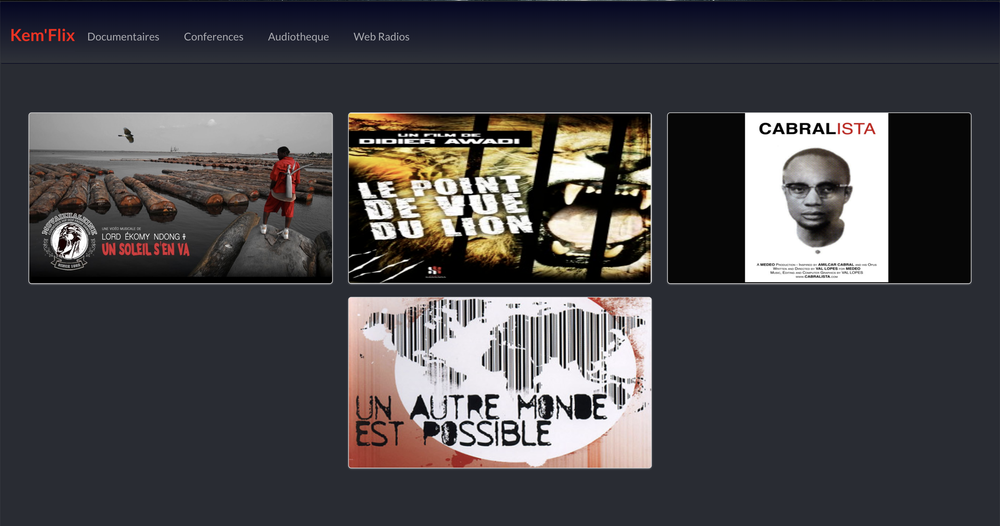
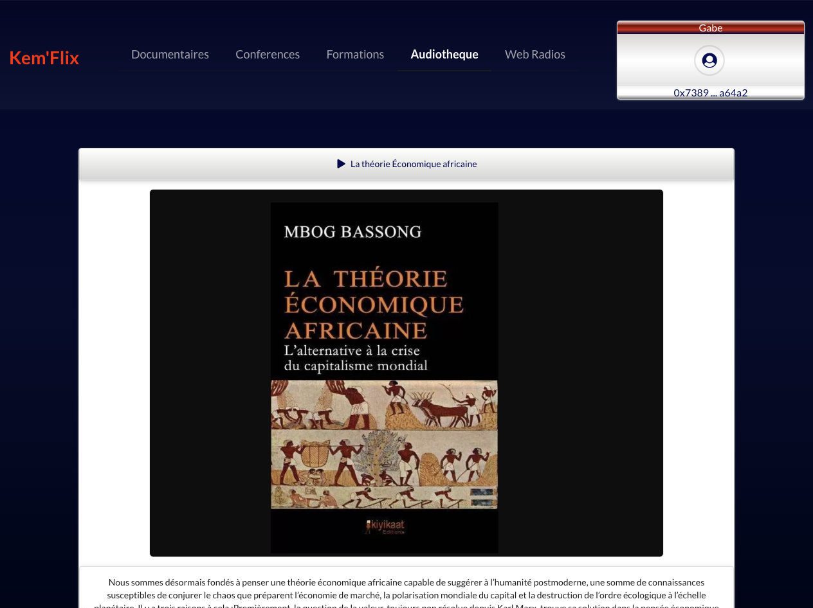

# KemFlix

**A Web3 media library for the Kemet cultural community — by Kemits, for Kemits.**

KemFlix gathers African and Afro-descendant culture and knowledge into one place: documentaries, animes, conferences, web radios, an audio library, audiobooks and courses. Membership is recorded on-chain rather than owned by a platform, so belonging to the community is something a member holds, not something a database grants.




---

## What it does

| Section | Content |
| --- | --- |
| Documentaires · Animes · Conférences | Curated video library |
| Audiothèque · Webradios | Streaming audio, built on `react-h5-audio-player` |
| Audiobooks | Long-form listening |
| Formations | E-learning tracks, including Ethereum/blockchain fundamentals and economic theory |

## Architecture

KemFlix pairs a conventional React frontend with an on-chain membership layer.

```
React 17 (CRA) ── Firebase Auth ──── account session
       │
       └── ethers v5 / useDApp ──── Diamond proxy (EIP-2535)
                                     ├── MembershipFacet  — register / check / revoke
                                     ├── AnkhTokenFacet   — ERC-20 (SolidState)
                                     ├── DiamondCutFacet  — upgrades
                                     ├── DiamondLoupeFacet
                                     └── OwnershipFacet
```

**Why a Diamond.** The contract backend uses the [EIP-2535 Diamond pattern](https://eips.ethereum.org/EIPS/eip-2535): one stable address, behaviour split across facets that can be added, replaced or removed through `diamondCut`. A media platform grows feature by feature — membership first, then a token, then whatever the community needs next — and the Diamond lets that happen without redeploying or migrating members.

**Membership.** `MembershipFacet` keeps a minimal on-chain register: a member calls `register(login)` with a chosen name, `checkMembership()` returns their status and name, and `revokeMembership()` lets them leave. Administrative operations are gated by the Diamond owner. The register stores a `bytes32` login and an address — no profile, no personal data.

**The Ankh token.** `AnkhTokenFacet` exposes an ERC-20 (via SolidState) from the same Diamond. The Ankh — the Kemetic sign of life — is the intended unit of participation for the community.

## Stack

React 17 · Semantic UI · ethers v5 · `@usedapp/core` · MetaMask onboarding · Firebase (auth + hosting) · Hardhat · Solidity 0.8

## Running it

```bash
# frontend
npm install
npm start          # http://localhost:3000

# contracts
cd backend
npm install
npx hardhat test
```

Deployment targets Firebase Hosting: `npm run deploy`.

## Status and honesty notes

This is a 2022 community project, kept public as a reference rather than maintained as production software.

- The `backend/` tree starts from [`mudgen/diamond-2-hardhat`](https://github.com/mudgen/diamond-2-hardhat); `MembershipFacet` and `AnkhTokenFacet` are the KemFlix-specific additions, alongside the reference `Test1Facet`/`Test2Facet` that ship with that template.
- `AnkhTokenFacet` is a thin SolidState ERC-20 — the token exists as a facet, but supply policy and distribution were never specified.
- Content access is not cryptographically enforced. Membership is recorded on-chain; gating the media itself against that record is unfinished work.
- Dependencies are from 2022 (React 17, CRA 4, ethers v5) and have known advisories. Do not deploy as-is.

## Lineage

KemFlix is where the Diamond-as-runtime idea started for me. The same architecture — a durable proxy whose facets behave like upgradeable modules — later became [Polkadot EVM Smart Runtime](https://github.com/knzeng-e/polkadot-evm-smart-runtime), which treats facets as pallets on Polkadot execution environments, and then the artist-owned `SmartRuntime` in [Dotify](https://github.com/knzeng-e/dotify).

## License

GPL-3.0
